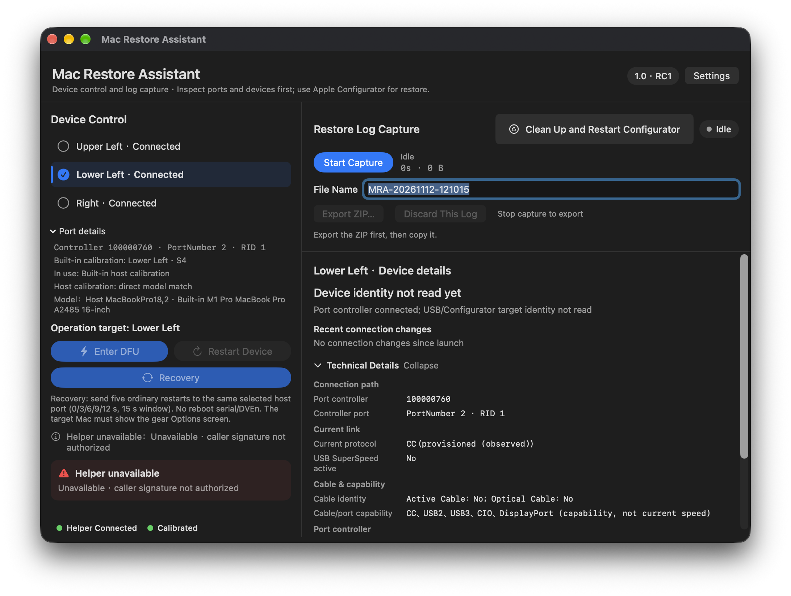
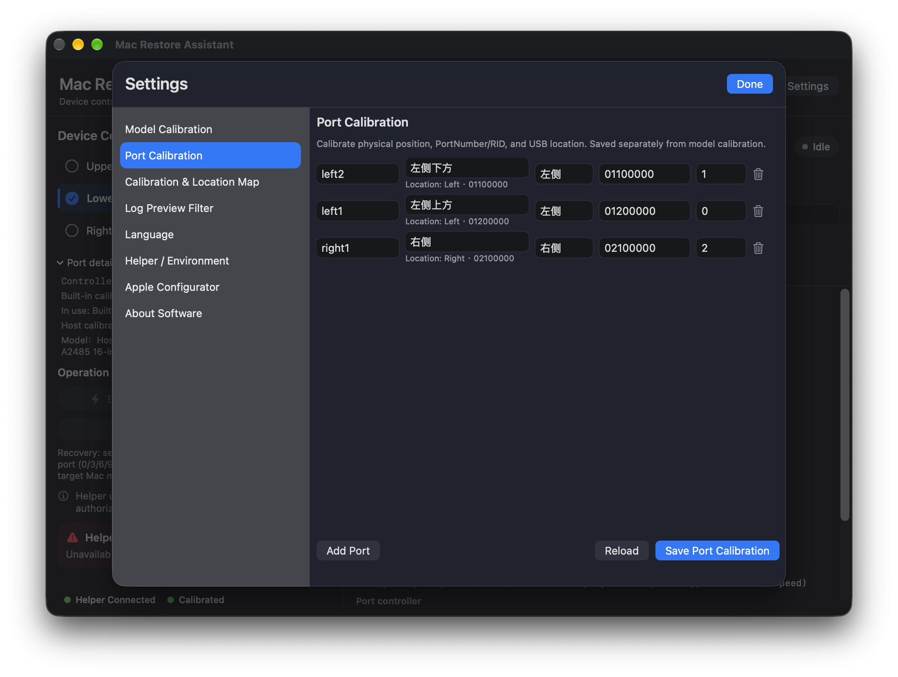
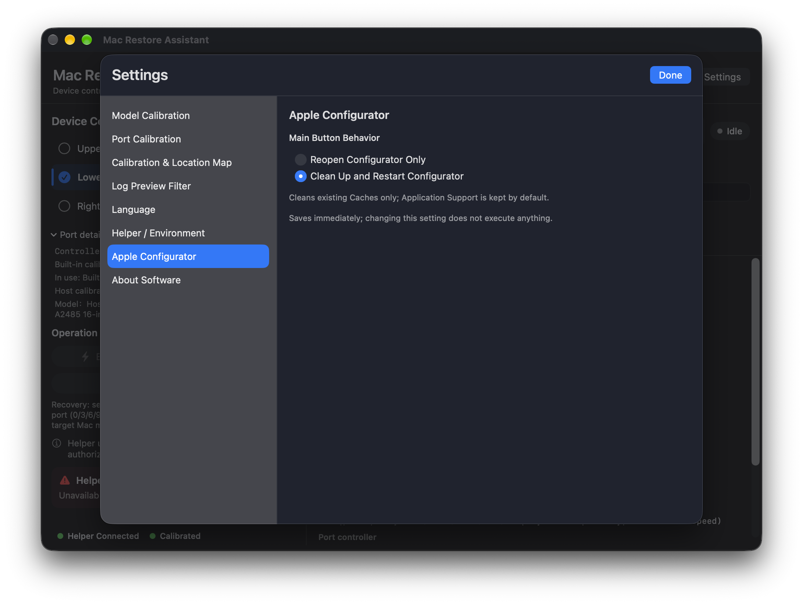

# Mac Restore Assistant

**A free tool for Mac repair technicians.** Select a physical host port to request DFU, restart, or Recovery (startup options), and capture logs while Apple Configurator performs a revive or restore.

## Download 1.0 RC

**[Download the 1.0 RC app](https://github.com/niubanxian1/Mac-Restore-Assistant/releases/tag/v1.0-rc1410)** · Apple silicon host · macOS 26 or later

This is a release candidate for real-device evaluation. DFU and Recovery workflows have been tried on individual devices, but the 1410 package and all hardware combinations have not been fully validated. The app uses an Apple Development signature; notarization and installation on a different Mac have not been verified. Some localized messages and layouts may still need work; in particular, the DFU double-send status can remain in Chinese when another language is selected.

SHA-256 of the app ZIP: `34852ab8fd7539bc341cfea6863a323d459420320480a46a874857ddc5285f37`

## Quick start

1. Connect the target Mac to the appropriate USB-C port on the host. Install or check the Helper from **Settings → Helper / Environment**; initial setup requires administrator authorization.
2. Select the host's physical port, check its calibration and use **Enter DFU**, **Restart Device**, or **Recovery**. A request receipt is not proof that the target reached the requested mode.
3. For firmware restore, use **Apple Configurator**. To capture a diagnostic log, select **Start Capture** before the operation, stop capture afterward, and export the ZIP. Logs can contain device identifiers and other sensitive information; review before sharing.
4. **Settings → Apple Configurator** chooses whether the home button only reopens Configurator or cleans existing caches and restarts it. The default keeps Application Support data.

## Interface

Representative English screenshots from the preceding UI candidate; the RC build number and feedback wording may differ.





## Build from source

The application is in `app/`; the user's independently developed RestoreLogEngine dependency is included separately under `vendor/RestoreLogMonitor/`. Swift 6 and an Xcode SDK that supports macOS 26 are required.

```sh
cd app
swift build -c release
cd ..
SIGN_IDENTITY="Apple Development: Your Name (TEAMID)" ./scripts/build-rc.sh
```

The build script refuses to overwrite an existing app. With no `SIGN_IDENTITY`, it creates an ad-hoc signed development build. **The bundled Helper accepts the configured app identifier and Team ID only**; an ad-hoc build or a different developer account cannot be assumed to control devices with that Helper. Its installation script also checks fixed Helper and backend hashes. A release for another signing identity requires appropriate Helper configuration, signing, packaging and real-device testing.

The checked-in pre-signed Helper/backend match RC 1410; rebuilding them changes their hashes and requires a corresponding, reviewed installer update. Two installer fixture tests in the original development environment used an older sealed Helper and failed its hash check; the final RC app passed a dry-run preflight. The source includes anonymized example identifiers in test/preview data.

## Acknowledgments

Thank you to the authors and maintainers whose work informed this project:

- [XRSec / DFU-Tools](https://github.com/XRSec/DFU-Tools)
- [Asahi Linux / macvdmtool](https://github.com/AsahiLinux/macvdmtool)
- [kylejericson / DFU_Tool](https://github.com/kylejericson/DFU_Tool)
- [waynebonc / Popeyes](https://github.com/waynebonc/Popeyes)
- [fcjr / restorekit](https://github.com/fcjr/restorekit)
- [Twocanoes / DFU Blaster Pro](https://twocanoes.com/products/mac/dfu-blaster/) · [version history](https://twocanoes.com/products/mac/dfu-blaster/history/) · [public downloads](https://bitbucket.org/twocanoes/dfu-blaster-public/downloads/)

## License

The project is available under the [MIT License](LICENSE). The derived direct RID backend includes Apache-2.0 components and their [license and notices](app/Sources/direct_rid_dfu/LICENSE); retain applicable third-party notices.
